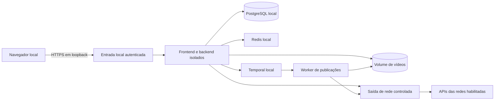

# Arquitetura local e limites de confiança

Estado em 2026-10-10: arquitetura com configuração candidata em `compose.local.yaml` e `var/local`; isolamento ainda não validado. Ver [retomada](C:/Claude/postiz-app/security-audit/plano-local/07-RETOMADA-E-CRITERIOS.md), especialmente R02 e R05–R07.

## Ambiente escolhido para o plano

Decisão mais recente do usuário: executar diretamente no Windows, sem Docker. O [plano Windows nativo](C:/Claude/postiz-app/security-audit/plano-local/08-WINDOWS-NATIVO.md) substitui as instruções de contêineres deste documento. Os detalhes abaixo de redes privadas, volumes e mounts são histórico da proposta anterior, não um procedimento de instalação atual.

Não executar o backend ou o frontend diretamente no Windows antes de resolver as dependências vulneráveis. Usar build de produção, sem servidor de desenvolvimento, depurador remoto ou interface de testes exposta. Executar Linux não dispensa atualizar Next.js e as outras dependências.

O diagrama mostra limites lógicos, não determina que todos os processos possam ficar no contêiner monolítico atual. Separar componentes conforme necessário para impor as restrições e manter apenas dependências realmente exigidas pelo código.

## Entrada: nenhuma exposição à internet ou à LAN

- Publicar somente a entrada da aplicação em um endereço de loopback do Windows. A origem candidata é `http://localhost:7443`; validar porta, TLS e callback exato antes de autorizar a rede piloto.
- No host, não usar bindings `0.0.0.0` ou `::`. Caso IPv6 seja utilizado, publicar apenas `::1`; caso contrário, comprovar que não há listener IPv6 alternativo.
- Backend pode escutar em uma interface da rede privada de contêineres para atender o gateway. Isso não autoriza publicar sua porta diretamente no Windows.
- PostgreSQL, Redis, Temporal e Elasticsearch, se necessário, ficam sem `ports` publicados. Não iniciar Spotlight, pgAdmin, RedisInsight ou Temporal UI no perfil cotidiano.
- Não usar modo de rede host, roteamento direto para contêineres, túneis, encaminhamento de portas do roteador ou UPnP para esta aplicação.
- Tratar firewall do Windows e a rede WSL/Docker como camadas que precisam de verificação, não como garantias presumidas. A regra deve valer em Wi-Fi, Ethernet, VPN, IPv4 e IPv6.
- Validar `Host`, `Origin` e origem de WebSocket no servidor. Rejeitar hostnames externos que resolvam para loopback e não confiar em cabeçalhos encaminhados por clientes. DNS rebinding é relevante mesmo sem publicar a aplicação.
- Configurar HTTPS local com certificado confiável para a origem escolhida. Não desligar validação de certificados, nem usar `NOT_SECURED=true` para fazer OAuth funcionar. Se não houver TLS compatível, parar e revisar o desenho antes de conectar contas.

A [documentação Docker](https://docs.docker.com/engine/network/port-publishing/) explica que omitir o IP publica portas em interfaces externas; também registra um problema de alcance por máquinas da mesma rede em versões anteriores a 28.0.0. Escolher runtime atualizado e confirmar o comportamento na máquina. Apenas escrever `127.0.0.1` em YAML não substitui o teste.

## Arquivos: o Postiz não deve enxergar a vida pessoal no Windows

- Importar vídeos pelo seletor de arquivos do navegador, para um volume dedicado do Postiz. Não montar `C:\`, a pasta do usuário, Documentos, Downloads, perfil do navegador ou pastas de outros projetos.
- Se houver necessidade futura de importação por pasta, criar uma pasta exclusiva com cópias dos vídeos escolhidos, montada somente para leitura. Não dar acesso à pasta original inteira.
- Não montar socket/API Docker, chaves SSH, diretórios `.aws`, `.codex`, senhas do navegador, tokens de Git ou agentes de credenciais.
- Separar volumes de mídia, banco, fila e configuração; controlar permissões por serviço. O worker recebe apenas os arquivos necessários para publicar.
- Rodar processos da aplicação como usuário sem privilégios; aplicar `no-new-privileges`, remover capabilities desnecessárias, limitar CPU/memória/PIDs e usar filesystem somente leitura onde compatível, com diretórios graváveis explícitos.
- Não usar `privileged`, não desativar globalmente seccomp e não conceder permissões amplas para resolver um erro de inicialização.
- Examinar camadas da imagem: segredos e `.env` não podem estar no build. Injetar segredos em runtime e restringir arquivos/ACLs. O processo poderá ler seus próprios segredos; o controle limita quem mais pode acessá-los.

## Saída: conteúdo só para a plataforma escolhida

- Desligar Sentry, Spotlight, PostHog, DataFast, pixels, analytics, newsletters, IA, serviços de clipping, armazenamento externo e recursos de cobrança desnecessários. Confirmar ausência de tráfego, além de limpar variáveis.
- Desabilitar no servidor MCP, relay, API pública, webhooks, RSS/autopost, importação por URL e integrações não utilizadas, salvo dependência funcional demonstrada. Ocultar botões não é suficiente.
- Criar uma lista de destinos por integração, com finalidade, método de autorização, dados enviados e revisão. Iniciar apenas com OAuth/API/upload e recursos indispensáveis da rede piloto. Avatares, thumbnails e CDNs são entradas externas e exigem validação.
- Não confiar somente em `HTTP_PROXY`/`HTTPS_PROXY`: uma biblioteca ou processo comprometido pode ignorá-las. O desenho precisa impedir saída direta por controles da rede isolada e permitir somente o componente de saída autorizado.
- Se usar proxy, restringir CONNECT a hosts/portas previstos, validar resolução/endereço de destino e bloquear IPs internos/loopback/link-local, redirects indevidos e acesso ao host. DNS deve usar caminho controlado; saída arbitrária por DNS/DoH não deve ser uma alternativa.
- Adaptar clientes HTTP que não respeitem o caminho de saída. Não abrir internet irrestrita porque um cliente falhou. Regras devem permitir respostas de conexões iniciadas pelo Postiz, sem aceitar conexões externas de entrada.
- Não fixar uma lista de IPs CDN presumidamente permanente. Registrar hosts efetivamente necessários, verificar sua titularidade e aplicar revisão; impedir que o próprio app altere a política de rede.
- O tráfego de navegador é uma superfície separada. Remover scripts externos não essenciais e aplicar CSP restrita no frontend. Um perfil dedicado reduz mistura de sessões, mas não é uma fronteira de segurança equivalente a uma VM.

Saída autorizada não elimina todo vazamento possível: um processo comprometido pode tentar incluir informações em uma publicação para um destino permitido. Por isso, o app deve ter poucos dados disponíveis, poucas permissões e exigir escolha explícita de conta, arquivo e conteúdo.

## OAuth e manutenção

O callback OAuth normalmente é uma navegação do navegador após autorização; isso não implica, por si só, que a plataforma precise acessar um servidor público. Contudo, cada plataforma impõe regras de registro e tipo de cliente. Conferir essas regras sem inserir intermediários externos.

Download de dependências e imagens ocorre em etapa de manutenção separada, sem tokens das redes. Não instalar pacotes automaticamente no início de uma sessão cotidiana. Fixar o artefato aprovado e reconstruí-lo de forma controlada após atualizações.
